# Hướng dẫn chèn kết quả Chương 6 vào tiểu luận v3

Các trang dưới đây là số trang in của Tieuluanv3.pdf; trang trong trình đọc PDF = trang in + 10. Số trang có thể thay đổi sau khi bạn chèn hình/bảng. Dùng số mục làm mốc chính.

Notebook thực nghiệm: TieuLuan_HeThongThongMinh.ipynb, từ tiêu đề CHƯƠNG 6 đến phần tổng kết. Chạy riêng Chương 6 sau khi Restart Kernel; không cần chạy lại Chương 2–5.

## 1. Những chỗ cần sửa mô tả trước khi gắn kết quả

- 6.4.1, trang 163–165: dùng Pima thật 768 mẫu, tám thuộc tính. File diabetes_dataset.csv 100.000 mẫu là bộ khác, không phải Pima. Không dùng kết quả Chương 2–3 của bộ 100.000 mẫu như kết quả trên cùng bộ Pima.
- 6.4.1 và 6.6.1: ghi rõ train/validation/test, thứ tự xử lý zero → NaN, fit imputer/scaler chỉ trên train. Glucose Pima là sau 2 giờ OGTT, không đổi nhãn thành glucose đói.
- 6.4.2, trang 165–166: bản notebook dùng đồ thị NetworkX có cạnh SUPPORTED_BY, TF-IDF và LSA. Neo4j, transformer embedding và LLM vẫn là hướng triển khai; không viết rằng đã đánh giá chúng. Kho này là tóm tắt tiếng Việt biên soạn thủ công có URL, không phải toàn văn phác đồ lâm sàng.
- 6.5.2: giữ 32 trạng thái và năm hành động cho nhiệm vụ cố định dự đoán kèm bằng chứng. Ba khoảng điểm p không phải mức độ bệnh. Truy vấn chỉ hỏi kiến thức đi nhánh riêng ngoài MDP.
- 6.5.4: bổ sung các hệ số reward và simulated tool cost từ cell MDP / run_config.json. Chi phí công cụ mô phỏng không phải ms đo được.
- 6.6.3: báo cáo Precision@3, Recall@3, Hit@3, OOD abstention, citation coverage và extractive support. Không đổi extractive support thành faithfulness ngữ nghĩa hoặc RAGAS; không báo tỷ lệ ảo giác LLM khi chưa chạy LLM.
- 6.6.4, trang 175–176: thay các ô “Chưa thực nghiệm” bằng Bảng 6.6; giữ đơn vị và mô tả cùng kịch bản đánh giá.
- 6.6.6: đọc cột evaluation_scope và metric trong Bảng 6.9; không so trực tiếp AUC với reward/pass rate.
- 6.8.2–6.8.4: giữ trạng thái thiết kế API/Web, chưa tích hợp trong lần này.
- 6.9: cập nhật đã có thực nghiệm notebook; không viết đã kiểm thử lâm sàng, triển khai Web hoặc chứng minh RL tối ưu.

## 2. Bảng kết quả và vị trí chèn

Bản dễ sao chép vào Word: [BANG_KET_QUA_DE_CHEN.html](BANG_KET_QUA_DE_CHEN.html) hoặc [bản Markdown](BANG_KET_QUA_DE_CHEN.md). CSV bên dưới lưu đầy đủ chữ số.

| Bảng | Mục | Trang in v3 | Tệp CSV (UTF-8 BOM) |
|---|---|---|---|
| Bảng 6.1. Đặc trưng và dữ liệu thiếu của Pima | 6.4.1 | 163–164 | [bang_6_01_du_lieu.csv](tables/bang_6_01_du_lieu.csv) |
| Bảng 6.2. Chia tập độc lập | 6.6.1 | 171–172 | [bang_6_02_chia_tap.csv](tables/bang_6_02_chia_tap.csv) |
| Bảng 6.3. Phân loại trên test: trung bình và độ lệch chuẩn qua 5 seed | 6.6.2 | 172–174 | [bang_6_03_phan_loai.csv](tables/bang_6_03_phan_loai.csv) |
| Bảng 6.4. Truy xuất trên 20 câu hỏi có bằng chứng và 4 câu ngoài miền | 6.6.3 | 174 | [bang_6_04_truy_xuat.csv](tables/bang_6_04_truy_xuat.csv) |
| Bảng 6.5. Chọn ngưỡng truy xuất trên validation (10 câu có bằng chứng, 2 câu ngoài miền) | 6.4.2 | 165–166 | [bang_6_05_nguong_validation.csv](tables/bang_6_05_nguong_validation.csv) |
| Bảng 6.6. Đối sánh chính sách trên cùng 600 kịch bản test, 5 seed | 6.6.4 | 175–176 | [bang_6_06_chinh_sach.csv](tables/bang_6_06_chinh_sach.csv) |
| Bảng 6.7. Độ nhạy siêu tham số trên validation mô phỏng | 6.7.6 | 179 | [bang_6_07_do_nhay.csv](tables/bang_6_07_do_nhay.csv) |
| Bảng 6.8. Kịch bản chức năng A–F: 60 trường hợp cho mỗi chính sách | 6.6.5 | 176–177 | [bang_6_08_kich_ban.csv](tables/bang_6_08_kich_ban.csv) |
| Bảng 6.9. Ablation theo phạm vi và chỉ số phù hợp với từng thành phần | 6.6.6 | 177 | [bang_6_09_ablation.csv](tables/bang_6_09_ablation.csv) |
| Bảng 6.10. Phân rã độ trễ thực đo (ms), môi trường CPU cục bộ | 6.7.5 | 179 | [bang_6_10_do_tre.csv](tables/bang_6_10_do_tre.csv) |

## 3. Hình và chú thích để chèn

PNG 240 dpi có thể chèn trực tiếp vào Word. SVG cùng tên phù hợp khi cần hình vector. Hình 6.1–6.7 là sơ đồ kiến trúc, Hình 6.8–6.13 dùng dữ liệu thực nghiệm.

### Hình 6.1. Chu trình hoạt động khép kín của AI Agent

Chèn tại **mục 6.1.1, trang 150**. Tệp: [hinh_6_1.png](figures/hinh_6_1.png).

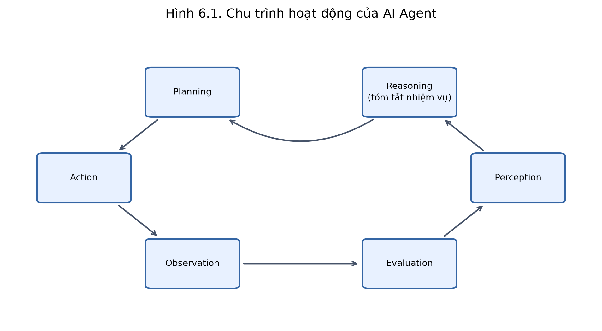

### Hình 6.2. Tương tác Agent–MDP; reward vận hành, không phải kết quả điều trị

Chèn tại **mục 6.2.2, trang 154**. Tệp: [hinh_6_2.png](figures/hinh_6_2.png).

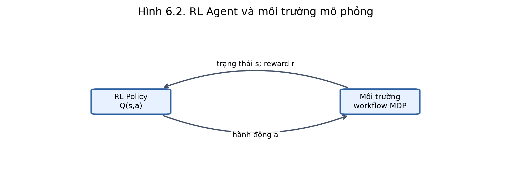

### Hình 6.3. Vòng lặp ReAct ở mức thao tác và quan sát; chưa triển khai LLM reasoning

Chèn tại **mục 6.2.4, trang 156–157**. Tệp: [hinh_6_3.png](figures/hinh_6_3.png).

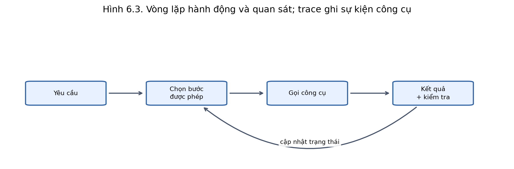

### Hình 6.4. Mô hình tập trung, phân cấp và cộng tác

Chèn tại **mục 6.2.5, trang 157–158**. Tệp: [hinh_6_4.png](figures/hinh_6_4.png).

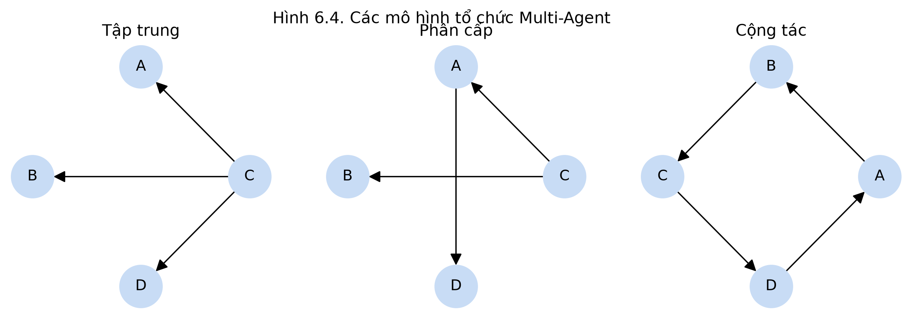

### Hình 6.5. Kiến trúc Multi-Agent thực nghiệm; API/Web là phần triển khai sau

Chèn tại **mục 6.3.2, trang 159–160**. Tệp: [hinh_6_5.png](figures/hinh_6_5.png).

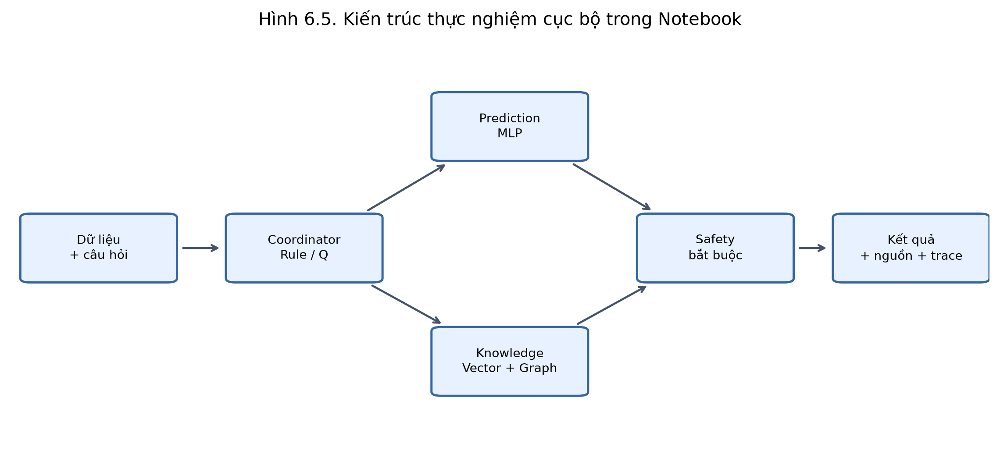

### Hình 6.6. Truy xuất lai cục bộ và kiểm chứng nguồn; không dùng Neo4j/LLM trong lần chạy này

Chèn tại **mục 6.4.2, trang 165–166**. Tệp: [hinh_6_6.png](figures/hinh_6_6.png).

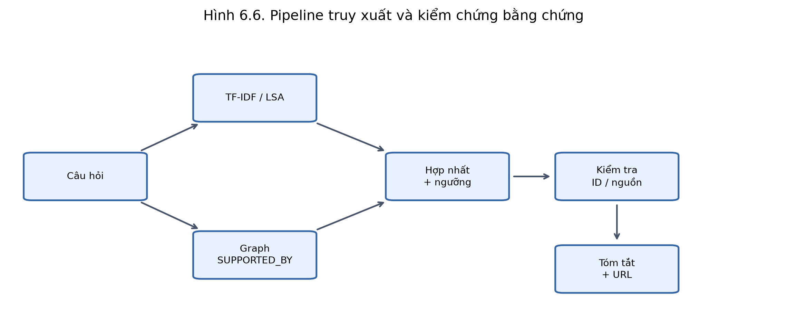

### Hình 6.7. Huấn luyện Q-learning và đánh giá không cập nhật Q

Chèn tại **mục 6.5.5, trang 170–171**. Tệp: [hinh_6_7.png](figures/hinh_6_7.png).

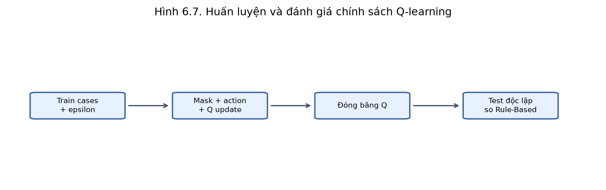

### Hình 6.8. Reward trung bình trượt 200 episode, trung bình ±1 SD qua 5 seed

Chèn tại **mục 6.7.1, trang 178**. Tệp: [hinh_6_8.png](figures/hinh_6_8.png).

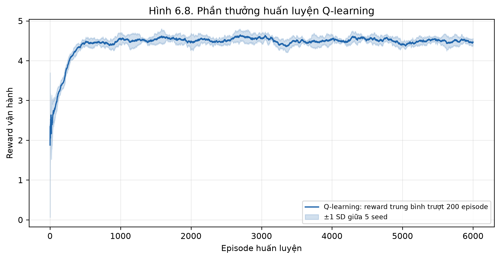

### Hình 6.9. Reward và Task Success Rate của các chính sách; sai số giữa 5 seed

Chèn tại **mục 6.7.2, trang 178**. Tệp: [hinh_6_9.png](figures/hinh_6_9.png).

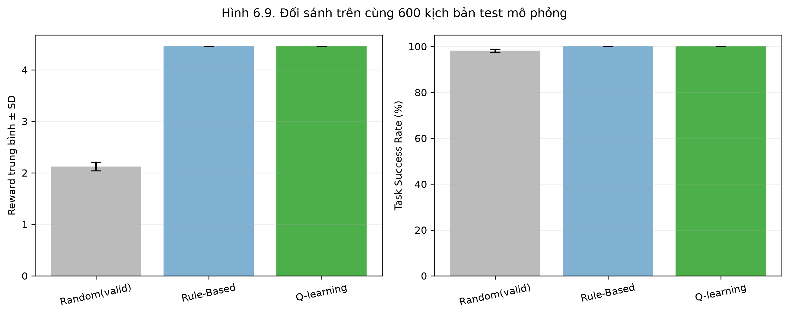

### Hình 6.10. Ma trận nhầm lẫn của MLP đại diện chọn theo validation

Chèn tại **mục 6.7.3, trang 178**. Tệp: [hinh_6_10.png](figures/hinh_6_10.png).

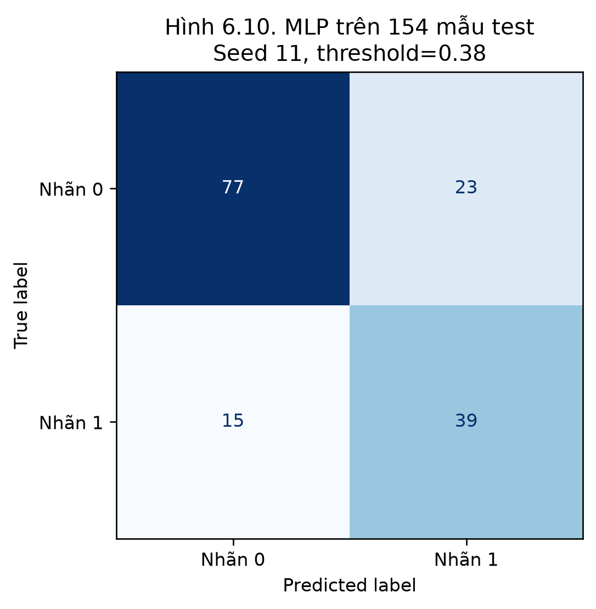

### Hình 6.11. ROC-AUC của ba mô hình đại diện, chọn seed theo validation

Chèn tại **mục 6.7.4, trang 178**. Tệp: [hinh_6_11.png](figures/hinh_6_11.png).

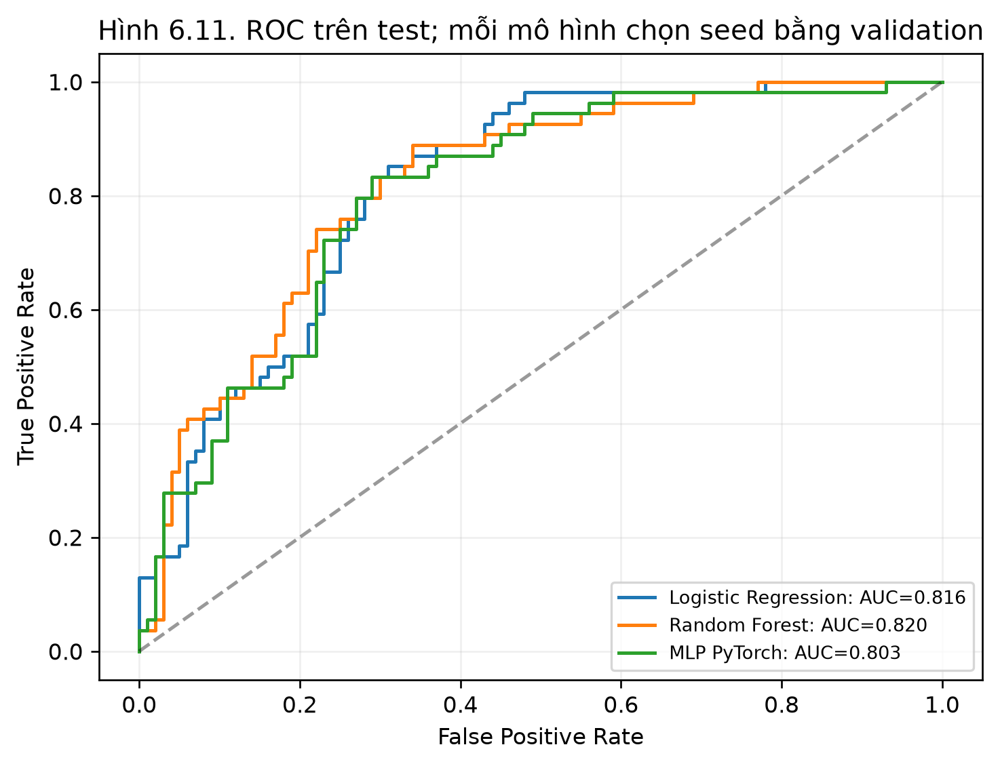

### Hình 6.12. Độ trễ thực đo ở nhóm A; gồm công cụ, Safety và overhead điều phối

Chèn tại **mục 6.7.5, trang 179**. Tệp: [hinh_6_12.png](figures/hinh_6_12.png).

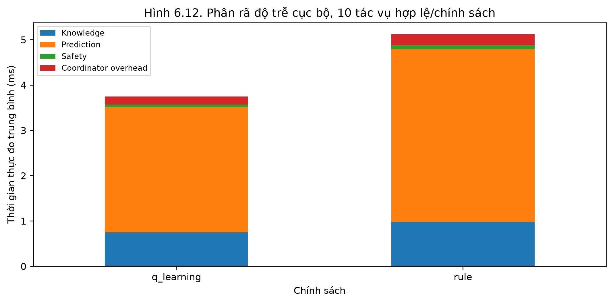

### Hình 6.13. Độ nhạy α và epsilon decay trên validation mô phỏng, cùng ngân sách

Chèn tại **mục 6.7.6, trang 179**. Tệp: [hinh_6_13.png](figures/hinh_6_13.png).

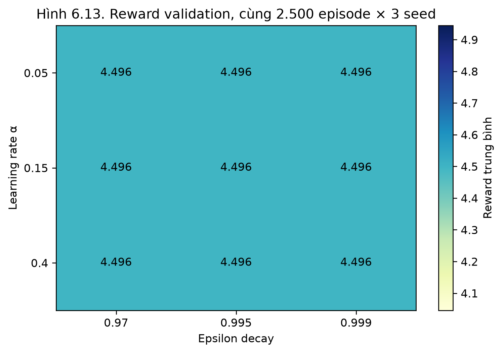

## 4. Nhận xét tham khảo từ lần chạy này

- Pima: train=491, validation=123, test=154. Cùng split stratified, năm seed huấn luyện; độ lệch chuẩn dưới đây không phản ánh mọi sai số do lấy mẫu.
- MLP trên test: ROC-AUC=0.8093 ± 0.0058; F1=0.6722 ± 0.0159; Brier=0.1715 ± 0.0022. Đây là hiệu suất phân loại trên nhãn nghiên cứu của Pima, không phải độ chính xác chẩn đoán lâm sàng.
- Hybrid Retrieval: Recall@3=0.9500; Precision@3=0.3167; OOD abstention=1.0000. Bộ test chỉ có 20 câu hỏi có bằng chứng và bốn câu ngoài miền, nhãn liên quan được biên soạn thủ công.
- Q-learning: reward=4.4519 ± 0.0000, success=100.00%; Rule-Based: reward=4.4519 ± 0.0000, success=100.00%. Q-learning và Rule-Based đạt reward trung bình bằng nhau trong độ chính xác số học của lần chạy. MDP nhỏ và baseline theo luật đã có đường xử lý ngắn; kết quả này chưa cho thấy lợi ích vượt baseline.
- Safety Violation Rate đo vi phạm thực thi sau action mask. Nếu bằng 0, chỉ có thể kết luận không quan sát vi phạm trong bộ kiểm thử này; không suy ra hệ thống an toàn tuyệt đối.
- Kịch bản chức năng: 120/120 trường hợp khớp hành vi mong đợi. Đã đạt 299 kiểm tra chương trình. Các trường hợp lỗi công cụ là failure injection được ghi rõ trong log.
- Hình 6.13: đọc độ nhạy thực tế; nếu heatmap gần như đồng nhất, chưa quan sát được khác biệt trong ngân sách và MDP đã chọn, không tự thêm kết luận về một vùng siêu tham số tối ưu.

## 5. Tái lập và giới hạn

- Cấu hình: artifacts/run_config.json; phiên bản: artifacts/environment.json; split: artifacts/split_indices.json.
- Các lượt mô hình: logs/model_runs.csv; lịch sử Q-learning: logs/q_learning_training.csv; episode đánh giá: logs/policy_episodes.json; kiểm thử: logs/verification_checks.json.
- Trọng số MLP chỉ là state_dict; kiến trúc Ch6MLP nằm trong notebook. Đã kiểm tra nạp lại model/preprocessor cho kết quả giống trước khi lưu.
- Phản hồi trích xuất và đồ thị nhỏ giúp kiểm chứng nguồn, nhưng chưa đánh giá sinh ngôn ngữ tự do, Cypher trên Neo4j, vector database, dữ liệu y khoa thực tế hoặc dịch vụ từ xa.
- Deadline trong Coordinator cục bộ được kiểm tra giữa các lời gọi đồng bộ; chưa đánh giá khả năng hủy một request mạng đang treo.
- Các chương 1–5 và project chưa được chạy lại/tích hợp trong lần này. Các số liệu mô phỏng ở Chương 5 không được dùng làm kết quả của Chương 6.

## 6. Nguồn dữ liệu và tri thức

- Pima tải từ: https://raw.githubusercontent.com/plotly/datasets/master/diabetes.csv; nguồn mô tả: https://www.openml.org/d/37; SHA-256: `123ce738f394095a201da0f65c5e174cdcb19cdf5ec1535aee65e2b0e1e2aae2`.
- D01 — Bệnh tiểu đường là gì?: https://www.niddk.nih.gov/health-information/diabetes/overview/what-is-diabetes (mục: Khái niệm; tóm tắt tiếng Việt, đối chiếu 2026-10-31).
- D02 — Triệu chứng và nguyên nhân: https://www.niddk.nih.gov/health-information/diabetes/overview/symptoms-causes (mục: Symptoms; tóm tắt tiếng Việt, đối chiếu 2026-10-31).
- D03 — Xét nghiệm và chẩn đoán: https://www.niddk.nih.gov/health-information/diabetes/overview/tests-diagnosis (mục: Blood tests; tóm tắt tiếng Việt, đối chiếu 2026-10-31).
- D04 — Theo dõi A1C và kế hoạch chăm sóc: https://www.niddk.nih.gov/health-information/diabetes/overview/managing-diabetes (mục: Diabetes ABCs / A1C; tóm tắt tiếng Việt, đối chiếu 2026-10-31).
- D05 — Lựa chọn thực phẩm: https://www.niddk.nih.gov/health-information/diabetes/overview/healthy-living-with-diabetes (mục: Meal planning; tóm tắt tiếng Việt, đối chiếu 2026-10-31).
- D06 — Vận động và lối sống: https://www.niddk.nih.gov/health-information/diabetes/overview/healthy-living-with-diabetes (mục: Physical activity; tóm tắt tiếng Việt, đối chiếu 2026-10-31).
- D07 — Phòng ngừa tiểu đường tuýp 2: https://www.niddk.nih.gov/health-information/diabetes/overview/preventing-type-2-diabetes (mục: Prevention; tóm tắt tiếng Việt, đối chiếu 2026-10-31).
- D08 — Thông tin về hạ đường huyết: https://www.niddk.nih.gov/health-information/diabetes/overview/preventing-problems/low-blood-glucose-hypoglycemia (mục: Symptoms / severe low glucose; tóm tắt tiếng Việt, đối chiếu 2026-10-31).
- D09 — Xét nghiệm theo dõi thận: https://www.niddk.nih.gov/health-information/kidney-disease/chronic-kidney-disease-ckd/tests-diagnosis (mục: CKD tests / GFR and albumin; tóm tắt tiếng Việt, đối chiếu 2026-10-31).
- D10 — Thuốc và trao đổi với đội ngũ chăm sóc: https://www.niddk.nih.gov/health-information/diabetes/overview/insulin-medicines-treatments (mục: Treatment choices; tóm tắt tiếng Việt, đối chiếu 2026-10-31).
