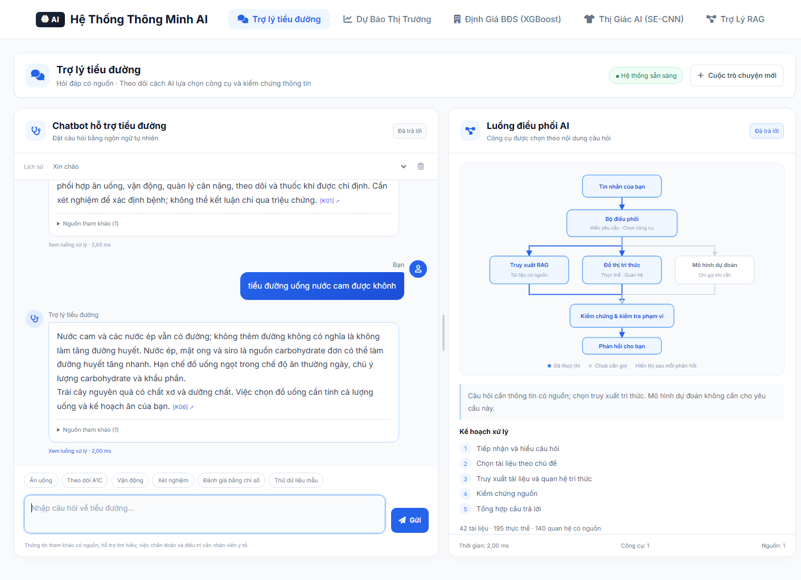
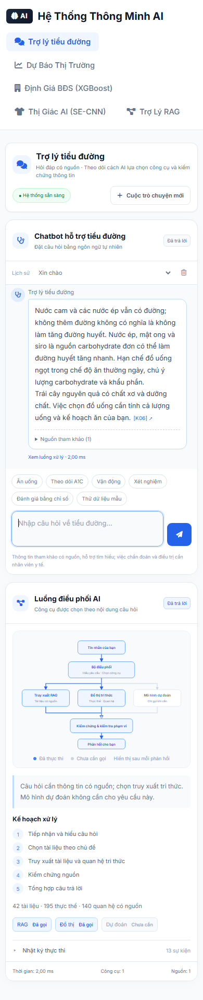
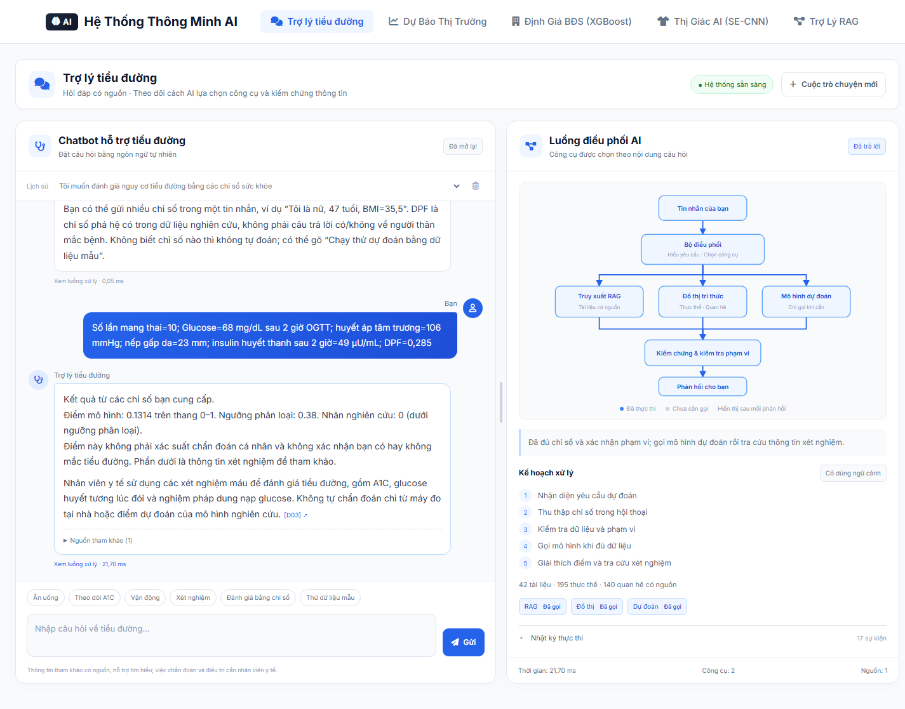

# Ghi chú chèn phần project vào tiểu luận v3

Các mốc là **mục của Chương 6**; trang dưới đây là số trang in trong bản v3 trước
khi bổ sung nội dung (trang PDF bằng trang in + 10). Bạn tự chèn vào bản tài liệu.

## Mục 6.8.1 — Kiến trúc triển khai, trang 179

Cập nhật mô tả từ thiết kế sang bản demo cục bộ đã hiện thực:

```text
Giao diện /agents (desktop/mobile)
    → Flask Blueprint /api/v1/*
    → AgentsModel: kiểm tra đầu vào → điều phối Rule-Based hoặc Q-learning
    → MLP / Knowledge Agent → kiểm chứng bằng chứng và phản hồi
    → SQLite: trạng thái tác vụ, bộ nhớ bổ sung dữ liệu, kết quả và trace
```

Mô hình và tiền xử lý nằm trong `model/diabetes/`; chỉ mục tri thức, đồ thị và
Q-table nằm trong `model/agents/`. Có script export từ notebook, kiểm tra checksum
và đối chiếu suy luận. Không huấn luyện trong HTTP request. Frontend gọi API cùng
ứng dụng Flask; chưa triển khai các dịch vụ độc lập qua mạng.

## Mục 6.8.2 — RESTful API, trang 179–180

Sáu API đề xuất trong v3 đã có bản hiện thực:

| Phương thức | Endpoint | Nội dung |
|---|---|---|
| POST | `/api/v1/predict` | Dự đoán với mô hình Pima đã đóng gói |
| POST | `/api/v1/knowledge/search` | TF-IDF, LSA hoặc truy xuất lai có nguồn |
| POST | `/api/v1/agents/execute` | Điều phối và tiếp tục tác vụ thiếu dữ liệu/bằng chứng |
| GET | `/api/v1/agents/status/<task_id>` | Kết quả và trace thuộc phiên hiện tại |
| POST | `/api/v1/safety/validate` | Kiểm tra dữ liệu, đơn vị và phạm vi xử lý |
| GET | `/api/v1/health` | Trạng thái phục vụ và thành phần đã nạp |

API bổ sung: cấu hình phiên `/api/v1/agents/session`, đối chiếu hai chính sách
`/api/v1/agents/compare`, đọc/xóa lịch sử `/api/v1/agents/history`.

Các luồng xử lý là đồng bộ. Endpoint status dùng để xem lại trạng thái/kết quả,
chưa phải cơ chế cập nhật tiến trình nền bằng polling hay WebSocket. Trạng thái
nghiệp vụ gồm ANSWERED, REQUEST_INFO, NO_EVIDENCE, ESCALATE và TOOL_OR_BUDGET_ERROR.

Có thể thêm một đoạn về kiểm tra tính nhất quán: điểm MLP được đối chiếu với trace
notebook; toàn bộ 72 cặp phương pháp/câu hỏi truy xuất đã lưu cũng được đối chiếu
với kết quả project. Kết quả ở `api_test_results.xml`.

## Mục 6.8.3 — Giao diện Web và Mobile, trang 180

Hai ảnh dưới đây được chụp từ ứng dụng đang chạy sau khi thao tác thật. Có thể
đánh số tiếp theo sau Hình 6.13, hoặc điều chỉnh theo thứ tự hình trong bản Word.

**Chú thích đề xuất:** Hình 6.14. Giao diện Trợ lý tiểu đường trên máy tính:
chatbot nhiều lượt và nguồn tham khảo ở bên trái; luồng điều phối, lựa chọn
công cụ và kiểm chứng ở bên phải. Thanh kéo giữa hai cột cho phép đổi độ rộng.



**Chú thích đề xuất:** Hình 6.15. Giao diện responsive trên màn hình rộng 390 px:
chat nhiều lượt, lịch sử trò chuyện và sơ đồ điều phối được sắp xếp phù hợp màn hình.



Mô tả các chức năng đã có: chat không cần chọn chế độ, nhận diện chủ đề, lập kế hoạch,
truy xuất và kiểm chứng nguồn, dùng ngữ cảnh cho câu hỏi tiếp nối, chọn một phản hồi
để xem lại luồng xử lý và lịch sử bền vững qua tải lại trang. Các API mô hình và
đối chứng được giữ riêng, không đưa biểu mẫu chỉ số vào giao diện chat.

Nhánh dự đoán đã nối vào hội thoại: câu “Tôi muốn đánh giá nguy cơ tiểu đường bằng
các chỉ số sức khỏe” kích hoạt thu thập dữ liệu. Chỉ khi đủ tám biến, xác nhận đơn vị,
thời điểm glucose và phạm vi mô hình, hệ thống mới gọi MLP đã đóng gói. Trạng thái
thiếu dữ liệu được lưu theo cuộc trò chuyện; không giả định DPF hay lấy dữ liệu mẫu
để điền vào hồ sơ người dùng. Câu “Chạy thử dự đoán bằng dữ liệu mẫu” cho phép demo
một lượt suy luận thật và được gắn nhãn mẫu rõ ràng.

Ảnh bổ sung có thể chèn tiếp tại phần mô tả lựa chọn công cụ:

**Chú thích đề xuất:** Chatbot thu thập chỉ số qua nhiều lượt, gọi mô hình dự đoán,
hiển thị điểm phân loại nghiên cứu và tô sáng nhánh công cụ đã thực thi.



Ảnh tương ứng trên điện thoại: `prediction_chat_mobile.png`. Điểm 0,1314 trong ảnh
là kết quả của mẫu minh họa đã xuất cùng mô hình, không phải chẩn đoán cá nhân.

Không kết luận Q-learning tốt hơn chỉ từ thời gian của một cặp request. Hai
chính sách dùng cùng mô hình dự đoán nên điểm mô hình khớp nhau.

## Mục 6.8.4 — Bộ nhớ phiên và kiểm soát truy cập, trang 181

Mô tả đúng phạm vi đã hiện thực: cookie phiên có chữ ký, CSRF token cho các request
ghi dữ liệu, tác vụ/lịch sử chỉ truy cập từ phiên sở hữu, kiểm tra schema, giới
hạn kích thước request, ngân sách thực thi và kiểm chứng nguồn đầu ra. Hồ sơ dùng
để bổ sung dữ liệu được lưu trong SQLite cục bộ; trace không chứa toàn bộ hồ sơ.
Có chức năng xóa lịch sử của phiên.

Đây chưa phải hệ thống tài khoản bệnh viện hoặc phân quyền bác sĩ/bệnh nhân.
Deadline được kiểm tra giữa các lời gọi đồng bộ; chưa kiểm chứng hủy request của
một dịch vụ từ xa bị treo. Không mô tả bản demo này như hệ thống lâm sàng đã triển khai.

## Mục 6.8.5 và 6.9 — Kết quả và giới hạn, trang 181–182

Các kiểm tra project đã đạt:

- 196 ca kiểm thử backend/API, gồm nạp LSTM bằng Keras/PyTorch, đối chiếu suy luận với trọng số gốc,
  trang dự báo và API 1/7/14/30 bước, giải thích nhóm phân loại và hỏi tiếp không thu thập lại hồ sơ,
  đọc hồ sơ nhiều dòng có tên viết tắt trong ngoặc, nạp artifact,
  đối chiếu chỉ mục gốc với notebook, chat nhiều lượt, ngữ cảnh,
  thiếu bằng chứng, lỗi công cụ, dữ liệu bị sửa, tách biệt phiên và lưu trữ tác vụ.
- 44 kiểm tra trình duyệt trên desktop/mobile, gồm tiêu đề phân loại rõ ràng cho cả câu trả lời lịch sử cũ,
  hỏi tiếp kết quả dự đoán và khôi phục phần giải thích,
  trả lời câu hỏi chuối từ kho mới, hồ sơ dán sau lượt demo, thu thập chỉ số,
  chạy MLP thật, khôi phục kết quả dự đoán,
  kéo giãn bằng chuột/phím và lưu tỉ lệ, đúng bố cục trái/phải, màu sắc thống nhất,
  chat dinh dưỡng, chuyển chủ đề, lời chào không gọi công cụ, xem/xóa lịch sử, không tràn ngang và không có
  lỗi JavaScript được quan sát.
- 8 kiểm tra riêng cho trang dự báo chuỗi thời gian: trả HTTP 200, vẽ Chart.js từ kết quả mô hình,
  bảng 7 bước, cập nhật 14 bước bằng AJAX, desktop/mobile và lỗi JavaScript.
  Ảnh: `reports/project/timeseries_fixed.png`; báo cáo: `reports/project/timeseries_browser_checks.json`.

Các số này là kiểm tra phần mềm trên dữ liệu và kịch bản nghiên cứu; không phải
kết quả đánh giá lâm sàng hoặc tỷ lệ xử lý thành công trên bệnh nhân thực tế.

Giữ các giới hạn từ notebook: đoàn hệ Pima hạn chế, TF-IDF/LSA và đồ thị cục bộ,
chính sách RL học trong mô phỏng. Neo4j và transformer embedding chưa triển khai.
Project có 168 tài liệu từ 163 trang nguồn, tăng bốn lần so với 42 tài liệu trước đó.
Đồ thị có 593 thực thể và 410 quan hệ chuyên môn; tổng 1736 nút/1418 cạnh có cả tài liệu,
nguồn và 812 bí danh, không gọi tất cả là thực thể y khoa. Thêm 126 tài liệu từ 126 URL
riêng biệt, có hash trang và trích đoạn nguồn, qua soạn thảo hỗ trợ bằng API, đối chiếu nguồn
ở lượt riêng và chỉnh sửa biên tập; chưa phải thẩm định lâm sàng.
Dữ liệu và danh mục nguồn ở `knowledge/diabetes_expansion.json`, `knowledge/diabetes_extended.json` và
`reports/project/knowledge_summary.json`.

Ảnh minh họa kho mới trả lời đúng trọng tâm câu “Tiểu đường tuýp 2 ăn chuối được không?”:
`corpus_expansion_chat.png`. Nguồn chọn là tài liệu trái cây cụ thể, không kèm tài liệu
định nghĩa tuýp 2 khi không cần thiết.

API tổng hợp Gemini được tích hợp ở server, dùng khóa môi trường/`.env`;
giao diện không hiển thị khóa hoặc tùy chọn nhà cung cấp. API chỉ nhận câu hỏi
và bằng chứng công khai đã truy xuất. Khi thiếu khóa hoặc gặp lỗi, hệ thống giữ
phản hồi cục bộ. Có kiểm tra schema, ID trích dẫn và trích đoạn hỗ trợ; chưa có
đánh giá lâm sàng về tính đúng của toàn bộ phát biểu sinh ra.

Bản project đã bổ sung mở rộng truy vấn theo chủ đề cho cách diễn đạt tiếng Việt
thông thường và nội dung dinh dưỡng được đối chiếu lại với NIDDK. Phần này nằm
ngoài chỉ mục thực nghiệm cố định; không gán các số đo benchmark cũ cho lớp hội
thoại mới. Ảnh kiểm tra đúng câu “Tiểu đường ăn được gì” nằm ở
`diet_question_fixed.png`.

Ứng dụng cục bộ mở tại `http://127.0.0.1:5000/agents`. Hướng dẫn chạy và demo chi tiết
nằm ở `README.md` tại thư mục gốc project. Không thay số liệu thực nghiệm Chương 6
bằng số liệu của các mô hình cũ hoặc số đo độ trễ trong một ảnh chụp màn hình.
